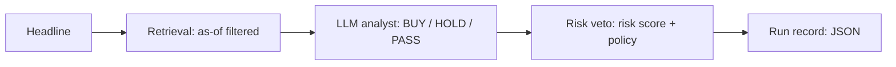

# AlphaGuard

**A harness for testing AI trade ideas without fooling yourself.** AlphaGuard is a method project: its goal is to prove the evaluation method, not to ship a trading edge. An LLM analyst proposes trades from financial news, a code-owned risk veto decides whether a BUY may pass, and the harness measures that veto on 8,907 real headline events.

[](https://github.com/Alpha-W0lf/alphaguard/actions/workflows/ci.yml) · License: PolyForm Noncommercial 1.0.0 · Runs locally with no API keys

## What it demonstrates

- **Point-in-time retrieval and features.** Features use only the last completed NYSE session before the headline, and retrieved context must be published before it. Tests check both.
- **An audit that caught a leak.** The harness audits its own splits. In an early pass, one tuned configuration cleared the floors on seed 42; the audit then found 92 same-ticker training rows whose 5-day label window reached into the locked test. I added a trading-day purge to the study harness's walk-forward and locked-test splits, with tests that fail if a training label window crosses a boundary (`tests/test_phase_c_audit.py`), and re-ran the configuration with the purge in place ([`docs/EXPERIMENTS.md`](docs/EXPERIMENTS.md) §7).
- **Floors held fixed across experiments.** The risk model predicts whether a stock falls more than 3% in the 5 trading days after a headline. Its floors (F1 ≥ 0.30, precision ≥ 0.25, AUPRC ≥ 0.18 on held-out data, on every seed) were set after the first baseline and held fixed for every later experiment. Studies run before 2026-10-18 shortlisted on locked-test F1, so their results are read as selection-biased ([`docs/PROMOTION_POLICY.md`](docs/PROMOTION_POLICY.md)).
- **Write-once runs.** Every run record is written once; study runs also record the git SHA, dataset hash and config hash, and a rerun takes a new id.
- **An LLM analyst checked by a code-owned risk veto.** The LLM proposes; a deterministic policy over a calibrated downside-risk score decides, so the model never approves its own idea.

No risk model has cleared the bar set in advance, and the harness reports that rather than overfitting to it.

## What I built

- **The veto architecture under test.** A LangGraph analyst on a local Ollama model returns BUY, HOLD or PASS as typed JSON, with one repair retry; the schema rejects anything else, and the app stamps event ID and ticker from the input, not the LLM. A calibrated downside-risk score plus a fixed policy table can veto a BUY. The veto loads a model only when its manifest and features match. Trained bundles are Platt-calibrated on a train-internal validation slice; the demo bundle is calibrated on synthetic data.
- **A point-in-time data pipeline that tests for leakage.** It turns a 1.4M-row news archive into 8,907 deduplicated events. A test changes every later price and checks that no feature moves, and in the study harness a trading-day purge keeps training label windows out of the next walk-forward block and the locked test.
- **A fixed-floor evaluation harness.** Study matrices run in parallel from YAML, with floors fixed before the run. Dataset-hash checks fail closed. Calibration, Fβ thresholds and shortlist ranking use out-of-sample validation scores; the default `train_f1_max` threshold is fit on the training rows, and the locked test is read only by the floor check. Run records are write-once. A multi-seed gate can only propose a candidate; a person makes the final call.

## How it works



1. Load a headline. Replay fixtures are the default; a Kafka path ingests live RSS into Qdrant.
2. Retrieve context published at or before the headline time, never the headline itself.
3. The LLM analyst proposes an action with a short rationale.
4. The veto scores downside risk. A BUY is rejected at or above the trained threshold. HOLD and PASS pass and keep their score.
5. Every run writes `artifacts/runs/<run_id>.json` once. LangSmith and Phoenix receive a trace when configured; a tracer failure never changes the decision.

## Try it (no keys, no model download)

```bash
uv sync
brew install libomp     # macOS only: XGBoost needs OpenMP
make test               # about 200 tests in about 15 s
make smoke-fixture      # headline -> context -> BUY -> veto -> run record
```

Expected output (abridged):

```
=== AlphaGuard smoke (replay) ===
model=fixture mode=replay rag_mode=fixture
status=success
obs.langsmith=skipped obs.phoenix=skipped
Agent1 proposal:  "action": "BUY", "confidence": 0.75
Agent2 decision:  "decision": "reject",
  "decision_reason": "BUY rejected: downside_risk_score=0.9405 >= score_threshold=0.2000"
```

With a local LLM: `ollama pull gemma4:e2b && make smoke`. API server: `make serve` (FastAPI on `127.0.0.1:8000`). Kafka, Qdrant and RSS: [`GETTING_STARTED.md`](GETTING_STARTED.md).

## How this was built

I direct coding agents under written gates. The contracts came first ([`docs/ARCHITECTURE.md`](docs/ARCHITECTURE.md)). Each later experiment had a written plan with floors and stop rules before it ran. Agents work from [`AGENTS.md`](AGENTS.md), and a bug fix ships with a test that fails on the old code. CI runs lint, the test suite and the fixture smoke on every PR.

## Repo map

| Path | What it holds |
|---|---|
| `src/alphaguard/` | Contracts, pipeline, analyst, risk veto, retrieval, API, telemetry, experiment harness |
| `tests/`, `eval/` | Unit and contract tests; 22 golden cases for schema, identity, as-of and veto rules |
| `docs/EXPERIMENTS.md` | The evaluation harness, the leakage audit and how to run a study |
| `docs/PROMOTION_POLICY.md` | The floors and who may promote a model |
| `docs/TRAINING_DATA.md` | Data source, as-of rules, features |
| `docs/ARCHITECTURE.md` | Contracts and failure modes |
| `docs/FINANCE_HONESTY.md`, `FAQ.md` | Scope of the project's claims; technical FAQ |

**Stack:** Python 3.12 (uv, 3.11+) · LangGraph · Ollama (`gemma4:e2b` default, `qwen3.5:4b` fallback) · XGBoost · scikit-learn · FastAPI · Kafka and Qdrant via Compose · LangSmith and Phoenix tracing.

## Next

- A live feature builder so the veto can score brand-new headlines, not only the replay set.
- An eval set for the LLM analyst (schema-pass rate, grounding, prompt-injection cases), gated in CI.
- A new fixed-floor study on a market-adjusted label with richer text features.

Built by Thomas Chacko, Senior AI Engineer (Ex-Meta). [LinkedIn](https://www.linkedin.com/in/tchacko1/)
